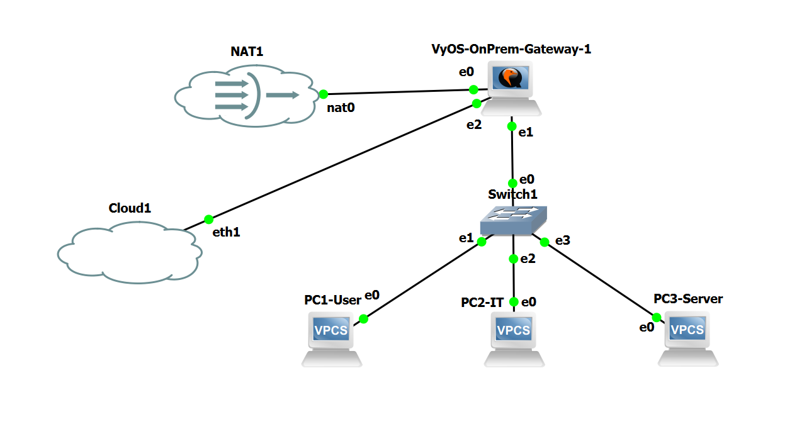

# On-Premises to AWS Site-to-Site VPN (GNS3 + VyOS)

I built this lab to connect a small on-premises network in GNS3 to a private AWS VPC over an IPsec Site-to-Site VPN. I started with VLANs, routing, and internet access on VyOS, then bridged the lab to my physical network so AWS could reach the customer gateway through my home router. After getting the first tunnel working, I configured the second tunnel and tested a primary/backup static-route setup.

The last part was a **manual failover test**: I disabled the primary static route, confirmed that the backup route was installed, and successfully pinged the private EC2 instance. I then restored the primary route. I did **not** implement or verify automatic tunnel-failure detection and failover.

## Final GNS3 topology

This is the completed **on-premises** topology, not a diagram of the AWS side. The VyOS router has three connections:

- `eth0` → GNS3 NAT, used for initial internet access tests and the source NAT rules shown in the lab.
- `eth1` → GNS3 switch on an 802.1Q trunk, with one VLAN per VPCS host.
- `eth2` → GNS3 Cloud / bridged physical LAN, used to reach the AT&T router and establish the AWS VPN from behind NAT.

An earlier version of the topology, before Cloud/`eth2` was connected, is preserved in [screenshot 01](screenshots/01-Onprem-Network-Topology.png).

## Network plan

| Location / device | Network or address | Purpose |
|---|---|---|
| VLAN 10 — Users (PC1) | `192.168.10.0/24` | VyOS gateway `192.168.10.1` |
| VLAN 20 — IT (PC2) | `192.168.20.0/24` | VyOS gateway `192.168.20.1` |
| VLAN 30 — Servers (PC3) | `192.168.30.0/24` | VyOS gateway `192.168.30.1` |
| VyOS `eth0` | GNS3 NAT-assigned address | Initial NAT/internet path; address can change |
| VyOS `eth2` | `192.168.1.10/24` | Bridged physical LAN |
| AT&T router | `192.168.1.254` | Physical LAN default gateway |
| AWS VPC | `10.100.0.0/16` | `Hybrid-OnPrem-AWS-VPC` |
| AWS public subnet | `10.100.1.0/24` | Public route table via IGW |
| AWS private subnet | `10.100.2.0/24` | Private EC2 test subnet |
| Private EC2 | `10.100.2.39` | ICMP testing over VPN; no public IPv4 |

**Region:** AWS US East (N. Virginia), `us-east-1`. The VPCS labels in the actual lab are `PC1-User`, `PC2-IT`, and `PC3-Server` (so VLAN 20 is **IT** and VLAN 30 is **Servers**, not the other way around).

## How I built it

### 1. Build and test the on-premises LAN

I installed VyOS in GNS3 and connected it to the GNS3 NAT node and an Ethernet switch. On VyOS, I created the VLAN interfaces `eth1.10`, `eth1.20`, and `eth1.30`, with `.1` as the default gateway for each /24. The GNS3 switch uses an 802.1Q trunk on port 0, and access ports on VLANs 10, 20, and 30 for the three VPCS hosts.

I confirmed routing between VLANs by pinging both the Users and Servers PCs from the IT PC. Then I configured source NAT/masquerade rules **100, 110, and 120** for all three VLAN subnets using `eth0`, and verified that each PC could ping `8.8.8.8`.

Evidence: [VyOS VLAN interfaces](screenshots/02-Vyos-VLAN-Interfaces.png), [switch port/VLAN configuration](screenshots/03-Switch-VLAN-Configuration.png), [inter-VLAN ping](screenshots/04-Inter-VLAN-Routing-Test.png), [source NAT rules](screenshots/05-Source-NAT-Configuration.png), and [internet tests from all three hosts](screenshots/06-VLAN-Internet-Connectivity-Test.png).

### 2. Connect VyOS to the physical network

To reach AWS from my home connection, I added the GNS3 Cloud/bridged connection on VyOS `eth2` and used `192.168.1.10/24` on that interface. I checked reachability to the AT&T router at `192.168.1.254` and to `8.8.8.8` from VyOS. On the AT&T router, I configured IPsec-related UDP port forwarding for **500** and **4500**, and checked that the VyOS/bridged device appeared on the home LAN.

This was a separate part of the lab from the original GNS3 NAT internet tests. In particular, the source NAT rules displayed in the earlier screenshots still point to `eth0`.

Evidence: [VyOS eth2 address](screenshots/07-VyOS-WAN-Static-IP.png), [gateway/internet pings](screenshots/08-VyOS-Internet-Connectivity.png), [AT&T IPsec port forwarding](screenshots/09-ATT-Router-IPsec-Port-Forwarding.png), and [physical LAN device verification](screenshots/10-ATT-Router-VyOS-Device-Verification.png).

### 3. Create the AWS network

I created a VPC with CIDR `10.100.0.0/16`, then added the public (`10.100.1.0/24`) and private (`10.100.2.0/24`) subnets. I attached an Internet Gateway and associated the public subnet with a route table containing `0.0.0.0/0 → IGW`. I kept the private subnet on a separate route table.

I also created and attached a Virtual Private Gateway (VGW), created a Customer Gateway (CGW) using the ISP-facing public IPv4, and then created **one AWS Site-to-Site VPN connection with two IPsec tunnels**. The VPN uses static routing; I did not configure BGP.

Evidence: [VPC settings](screenshots/11-AWS-VPC-Configuration.png) through [VPN details](screenshots/20-AWS-Site-to-Site-VPN-Details.png). Screenshot 16 is the **initial** private route table before the on-prem return routes were added.

### 4. Configure Tunnel 1 and route traffic to the VPC

At first, both tunnels showed as **Down** in AWS. I configured the first IPsec tunnel on VyOS and verified it came **Up** on both AWS and VyOS. I also launched a `t3.micro` EC2 instance in the private subnet with address `10.100.2.39` and no public IPv4 address.

Before adding the VPC route, a VyOS lookup for the EC2 address matched the ordinary default route toward the home router. I added a static route for `10.100.0.0/16` through `vti0`; the new lookup then selected that VTI. On AWS, I added return routes for the three on-premises /24 networks through the VGW and allowed the relevant ICMP traffic in the EC2 security group.

After that, I could ping the EC2 private address from VyOS and from **all three** VPCS hosts across the VPN. I also checked the IPsec Security Association (SA) packet/byte counters to verify traffic was crossing the tunnel.

Evidence: [both tunnels initially Down](screenshots/21-AWS-VPN-Tunnel-Status-Before-Configuration.png), [Tunnel 1 Up](screenshots/22-AWS-Site-to-Site-VPN-Tunnel1-UP.png), [private EC2](screenshots/23-AWS-Private-EC2-Instance-Running.png), [VyOS IPsec SA](screenshots/24-VyOS-IPsec-VPN-Tunnel1-UP.png), [route change to vti0](screenshots/25-VyOS-AWS-Static-Route-Vti0.png), [AWS return routes](screenshots/26-AWS-Private-Route-Table-Configured.png), and [VyOS ping](screenshots/27-VyOS-to-AWS-EC2-VPN-Ping-Success.png)–[IPsec counters](screenshots/31-VyOS-IPsec-VPN-Encrypted-Traffic-Verification.png).

### 5. Configure Tunnel 2 and test a backup route

I configured the second IPsec tunnel and confirmed both IPsec SAs were **Up**. I used a higher administrative distance for the backup route to AWS:

| Destination | Interface | Distance | Intended role |
|---|---|---:|---|
| `10.100.0.0/16` | `vti0` | `1` | Primary route |
| `10.100.0.0/16` | `vti1` | `20` | Backup route |

With both static routes enabled, the routing output showed `vti0` as **best / Installed**, while `vti1` was present but not installed. I also pinged the AWS-side Tunnel 2 inside address from VyOS: **5 sent, 5 received**.

For the failover test, I **manually disabled the `vti0` static route**, committed the change, and confirmed that `vti1` became **best / Installed**. The ping to private EC2 `10.100.2.39`, sourced from `192.168.10.1`, succeeded with **5/5 replies**. I then removed the `disable` setting from the primary route, committed and saved the configuration, and confirmed `vti0` was selected again. The final EC2 connectivity test after restoration also succeeded.

This proves that the **backup route and tunnel carried traffic during a controlled manual route failover**. It does not by itself prove that an unplanned tunnel outage would trigger automatic failover.

Evidence: [both VyOS tunnels Up](screenshots/32-VyOS-Both-AWS-IPsec-Tunnels-UP.png), [routing priorities](screenshots/33-VyOS-Primary-Backup-Static-Routes.png), [Tunnel 2 inside ping](screenshots/34-AWS-Tunnel2-VTI-Ping-Success.png), [backup route installed after manual change](screenshots/35-AWS-VPN-Primary-to-Backup-Failover-Verification.png), [backup EC2 ping](screenshots/36-AWS-VPN-Backup-Tunnel-EC2-Ping-Success.png), [primary route restored](screenshots/37-AWS-VPN-Primary-Tunnel-Restored.png), and [both AWS tunnels Up](screenshots/38-AWS-Site-to-Site-VPN-Both-Tunnels-UP.png).

## Tunnel addresses

| Setting | Tunnel 1 (primary route) | Tunnel 2 (backup route) |
|---|---|---|
| AWS outside endpoint | `23.21.116.145` | `54.87.195.130` |
| VyOS inside address | `169.254.94.50/30` | `169.254.115.70/30` |
| AWS inside address | `169.254.94.49/30` | `169.254.115.69/30` |
| VyOS VTI | `vti0` | `vti1` |

The working SA output showed **AES-CBC-256 / HMAC-SHA2-256 / MODP-2048**. The generic AWS VPN configuration download included example proposals that were **not** the same as the working SA output, so I used the actual VyOS verification when describing the result. The pre-shared keys are deliberately not included in this repository.

## Troubleshooting notes

The lab did not work on the first attempt. These are the issues I spent the most time on:

- **GNS3 Cloud / physical LAN access:** VyOS initially could not reach the AT&T gateway reliably. I checked the bridged connection, the `eth2` address and routing, then verified both the home gateway and internet connectivity from VyOS.
- **Wrong route to the AWS EC2 subnet:** The first route lookup went toward the ordinary default gateway. Adding the VPC static route through `vti0`, alongside the AWS-side return routes, gave the VPN a working path in both directions.
- **Tunnel 2 authentication:** Tunnel 2 did not come up until I corrected a mismatched pre-shared key in the VyOS configuration and restarted/rechecked the connection. I did not save that key in GitHub.
- **Testing the backup path:** Seeing both tunnels Up was not enough. I checked the routing table before and after disabling the primary route, then sent actual test traffic to the EC2 instance.

## What I verified

| Test | Result | Screenshot |
|---|---|---|
| Inter-VLAN reachability | Successful pings from IT to Users and Servers | [04](screenshots/04-Inter-VLAN-Routing-Test.png) |
| Internet reachability from all three VLANs | 5 replies per PC from `8.8.8.8` | [06](screenshots/06-VLAN-Internet-Connectivity-Test.png) |
| VyOS to physical gateway/internet | 4/4 pings to both test destinations | [08](screenshots/08-VyOS-Internet-Connectivity.png) |
| VyOS to private AWS EC2 | 5/5 replies | [27](screenshots/27-VyOS-to-AWS-EC2-VPN-Ping-Success.png) |
| PC1 / VLAN 10 to EC2 | Successful | [28](screenshots/28-PC1-VLAN10-to-AWS-EC2-VPN-Ping-Success.png) |
| PC2 / VLAN 20 to EC2 | Successful | [29](screenshots/29-PC2-VLAN20-to-AWS-EC2-VPN-Ping-Success.png) |
| PC3 / VLAN 30 to EC2 | Successful | [30](screenshots/30-PC3-VLAN30-to-AWS-EC2-VPN-Ping-Success.png) |
| Encrypted tunnel traffic | Non-zero IPsec SA byte/packet counters | [31](screenshots/31-VyOS-IPsec-VPN-Encrypted-Traffic-Verification.png) |
| Tunnel 2 inside-interface connectivity | 5/5 replies | [34](screenshots/34-AWS-Tunnel2-VTI-Ping-Success.png) |
| Manual failover onto backup VTI | `vti1` selected, EC2 ping 5/5 | [35](screenshots/35-AWS-VPN-Primary-to-Backup-Failover-Verification.png), [36](screenshots/36-AWS-VPN-Backup-Tunnel-EC2-Ping-Success.png) |
| Manual restoration of primary VTI | `vti0` reinstalled as best route | [37](screenshots/37-AWS-VPN-Primary-Tunnel-Restored.png) |
| Final AWS tunnel status | Both tunnels Up | [38](screenshots/38-AWS-Site-to-Site-VPN-Both-Tunnels-UP.png) |

## Scope and limitations

This is a hands-on learning lab, not a production high-availability deployment. I used **static routes**, not BGP. The failover exercise changed a route **manually**; automatic health monitoring, dynamic route withdrawal, and end-to-end high availability were outside the tested scope. Most validation was ICMP connectivity and IPsec SA state/counters, not throughput or application performance testing.

The GNS3 topology screenshot only covers the on-prem side. AWS resource and VPN screenshots show the cloud side and test results. Some setup screenshots were taken before later changes; they document the build sequence rather than claiming every configuration was present from the start.

## Screenshots and security

All 39 screenshots are in [`screenshots/`](screenshots/), with a short description of each in the [screenshot index](docs/Screenshot-Index.md). The last screenshot is the completed GNS3 on-prem topology.

I left out private keys and pre-shared keys. Identifying details such as my home public IP, home Wi-Fi name, and AWS account number have been masked in the public screenshot copies. **Do not commit the AWS-downloaded VPN configuration file**, since it contains live pre-shared keys.

## What I learned

This lab made the difference between having a tunnel marked **Up** and having a usable **route through it** much clearer. The work was mostly about making the paths line up: VLAN gateways, NAT, the bridged physical interface, IPsec, VTI routes, AWS return routes, and the EC2 security group. The most useful test was checking the routing table before and after I changed the primary route, rather than assuming the second tunnel would be used just because it was connected.
